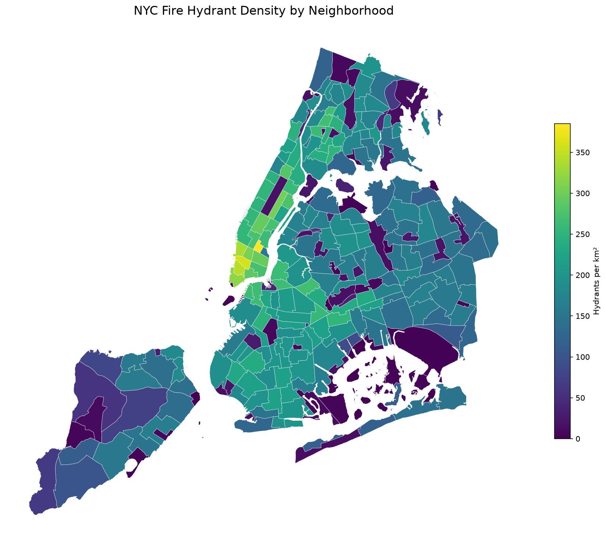
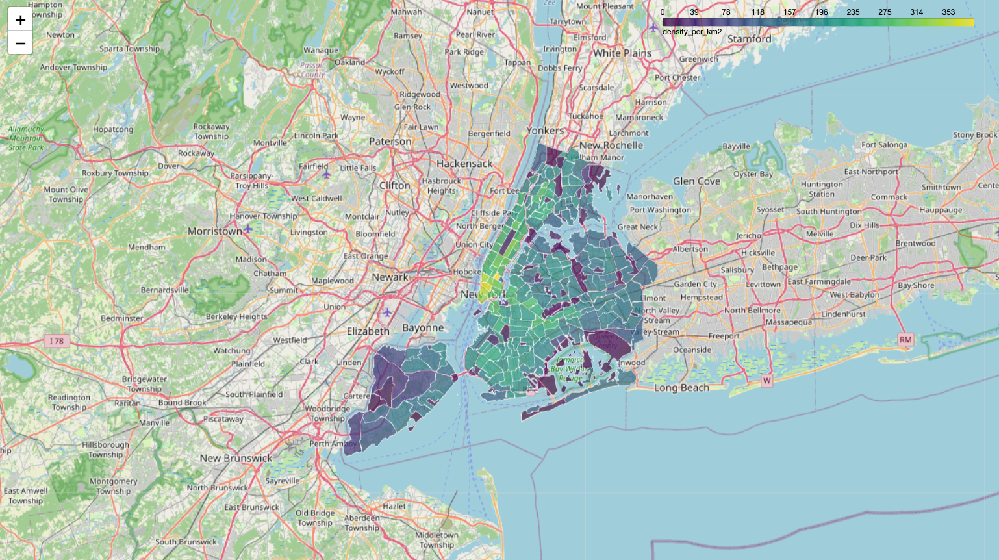

# NYC Fire Hydrant Density & Coverage Analysis

A comparative spatial analysis of 109,725 fire hydrants across 262 New York City neighborhoods using PostgreSQL/PostGIS and Python/GeoPandas.

The project implements the same spatial analysis in two environments, comparing SQL-based geospatial processing with Python-based analytical workflows and visualization.

## The Question

Where is fire hydrant density highest across NYC neighborhoods, and which areas have the lowest geographic coverage relative to their size?

Two complementary metrics are evaluated:

- **Hydrant density:** Number of hydrants per square kilometer of neighborhood area.
- **Hydrant coverage:** Percentage of neighborhood area within 100 meters of a mapped hydrant.

## The Data

| Dataset | Features | Geometry |
|---|---:|---|
| NYC Neighborhoods | 262 | Polygons |
| NYC Fire Hydrants | 109,725 | Points |

**Source:** NYC Open Data, using the datasets provided for the Modern GIS Accelerator exercises.

**Source CRS:** EPSG:4326 (WGS 84)

**Analysis CRS:** EPSG:26918 (NAD83 / UTM Zone 18N)

EPSG:26918 was selected for the analysis because it uses meters, allowing area calculations in square kilometers and distance operations in meters.

Raw GeoJSON files are stored locally in `data/raw/` and excluded from Git version control.

## Methodology

The analysis was independently implemented using PostGIS SQL and GeoPandas.

### 1. PostGIS Analysis

Five progressively more complex SQL queries were developed in `analysis.sql`:

1. **Attribute filtering:** Identify Manhattan neighborhoods using `WHERE`.
2. **Spatial joining:** Associate hydrant points with neighborhood polygons using `ST_Contains()`.
3. **Aggregation:** Calculate hydrant counts by neighborhood using `COUNT()` and `GROUP BY`.
4. **Density normalization:** Calculate neighborhood area using `ST_Transform()` and `ST_Area()`, then determine hydrants per square kilometer.
5. **Coverage analysis:** Create 100-meter hydrant buffers, union overlapping geometries, and intersect the resulting coverage with neighborhood polygons.

The final density and coverage analyses include all 262 neighborhoods.

A `LEFT JOIN` retains neighborhoods with zero matched hydrants.

For coverage, a `LEFT JOIN LATERAL` selects hydrants within 100 meters of each neighborhood, including hydrants immediately outside neighborhood boundaries.

### 2. Spatial Query Optimization

The initial citywide coverage query was computationally expensive because coordinate transformations within `ST_DWithin()` prevented efficient use of the original geometry index.

A functional GiST spatial index was created on the hydrant geometries transformed to EPSG:26918:

```sql
CREATE INDEX IF NOT EXISTS idx_hydrants_utm18
ON nyc_hydrants
USING GIST (ST_Transform(wkb_geometry, 26918));

ANALYZE nyc_hydrants;
```

Using `EXPLAIN ANALYZE`, PostgreSQL was confirmed to use the new index.

A test querying hydrants within 100 meters of Financial District–Battery Park City returned 661 hydrants in approximately 102 milliseconds.

The optimized query eliminates the need for an approximate degree-based preliminary distance filter while retaining an exact metric distance calculation.

### 3. GeoPandas Analysis

The same analytical workflow was reproduced in `analysis.ipynb` using:

- `gpd.read_file()` for GeoJSON ingestion.
- Boolean filtering for neighborhood selection.
- `gpd.sjoin()` for point-in-polygon spatial joins.
- `groupby()` for hydrant counts.
- `.to_crs()` and `.area` for density normalization.
- `.buffer()`, `.union_all()`, and `.intersection()` for geographic coverage.

The notebook also creates a static choropleth using Matplotlib and an interactive map using GeoPandas `.explore()` and Folium.

The final neighborhood-level dataset is exported to GeoParquet.

## Findings

### Highest hydrant density

| Neighborhood | Borough | Hydrants/km² |
|---|---|---:|
| Gramercy | Manhattan | 384.97 |
| SoHo–Little Italy–Hudson Square | Manhattan | 360.22 |
| Tribeca–Civic Center | Manhattan | 343.47 |
| West Village | Manhattan | 333.94 |
| Financial District–Battery Park City | Manhattan | 319.31 |

All five highest-density neighborhoods are in Manhattan.

Gramercy has more than twice the median neighborhood hydrant density.

### Lowest hydrant density

| Neighborhood | Borough | Hydrants/km² |
|---|---|---:|
| The Evergreens Cemetery | Brooklyn | 0.00 |
| Jamaica Bay (West) | Brooklyn | 0.00 |
| Hoffman & Swinburne Islands | Staten Island | 0.00 |
| Fort Wadsworth | Staten Island | 1.09 |
| Shirley Chisholm State Park | Brooklyn | 1.18 |

The lowest-density neighborhoods consist largely of nonresidential areas, including parks, cemeteries, and islands.

### Summary statistics

| Metric | Result |
|---|---:|
| Median neighborhood density | 165.6 hydrants/km² |
| Median 100-meter coverage | 95.17% |
| Mean 100-meter coverage | 79.45% |
| Financial District–Battery Park City coverage (PostGIS) | 94.29% |

The difference between median and mean coverage indicates that neighborhoods with particularly low coverage exert a substantial influence on the citywide neighborhood average.

Coverage statistics represent unweighted averages across neighborhoods, not the percentage of total NYC land area covered.

### Hydrant Density Map



*Neighborhood-level hydrant counts normalized by polygon area (km²).*

### Interactive Map
 


*Interactive GeoPandas/Folium visualization showing neighborhood density and associated attributes.*

## Interpretation and Limitations

Hydrant density and geographic coverage provide different measures of distribution.

A neighborhood may have high hydrant density while still containing localized areas beyond 100 meters from a mapped hydrant.

Several low-density neighborhoods contain extensive parkland, cemeteries, airport facilities, or islands. Low measured density therefore does not necessarily indicate inadequate fire protection.

Additional considerations include:

- Hydrant operational condition and water supply capacity were not evaluated.
- Straight-line buffer distances do not represent travel distance or accessibility.
- Neighborhood boundaries include land uses with substantially different infrastructure requirements.
- Results depend on the completeness and accuracy of the underlying NYC Open Data datasets.
- Circular buffers are approximated using polygon segments, which can produce small differences between spatial processing libraries.

The analysis measures geographic proximity to mapped hydrants rather than fire protection adequacy or regulatory compliance.

## SQL and Python Validation

The analysis was implemented separately in PostGIS and GeoPandas using the same source datasets and EPSG:26918 projected coordinate system.

An initial coverage comparison for Financial District–Battery Park City produced:

| Environment | Coverage |
|---|---:|
| PostGIS | 94.29% |
| GeoPandas | 94.3058% |

The small difference prompted examination of buffer polygon resolution, which differs between the default implementations of PostGIS and GeoPandas.

### SQL and Python Validation

The spatial analysis was independently implemented in PostGIS and GeoPandas using the same NYC source datasets.

Both implementations use EPSG:26918 for distance and area calculations and equivalent buffer resolutions for the 100-meter coverage analysis.

The five highest-density neighborhoods produced identical hydrant counts and density values to two decimal places across both environments.

The 100-meter geographic coverage calculation for Financial District–Battery Park City also agreed at **94.29%**.

Initial differences were traced to inconsistent projected coordinate systems and buffer resolution. Standardizing these parameters produced matching results.

## Project Structure

```text
nyc-hydrant-analysis/
├── analysis.sql
├── analysis.ipynb
├── README.md
├── .gitignore
├── LICENSE
├── data/
│   ├── raw/
│   │   ├── nyc_neighborhoods.geojson
│   │   └── nyc_hydrants.geojson
│   └── processed/
│       └── hydrant_density.parquet
└── images/
    ├── density_choropleth.png
    └── hydrant_density_interactive.png
```

The raw datasets are excluded from GitHub using `.gitignore`.

## How to Run

### Requirements

- Python 3.11 or newer with GeoPandas, pandas, Matplotlib, PyArrow, Folium, mapclassify, and Jupyter/IPython kernel support.
- PostgreSQL with PostGIS, running locally or through Docker.
- The two NYC GeoJSON source datasets.

### 1. Clone the repository

```bash
git clone https://github.com/carneyam/nyc-hydrant-analysis.git
cd nyc-hydrant-analysis
```

### 2. Set up Python

```bash
python3 -m venv .venv
source .venv/bin/activate
python -m pip install geopandas pandas matplotlib pyarrow ipykernel folium mapclassify
```

### 3. Prepare the source datasets

Place `nyc_neighborhoods.geojson` and `nyc_hydrants.geojson` in `data/raw/`.

### 4. Run the PostGIS analysis

Start an available PostgreSQL/PostGIS instance and load the two source datasets into tables named:

- `nyc_neighborhoods`
- `nyc_hydrants`

The SQL assumes the neighborhood table contains `ntaname`, `boroname`, and `wkb_geometry`, and the hydrant table contains `gid` and `wkb_geometry`.

With the tables loaded, execute:

```bash
psql -h localhost -U gis -d gis -f analysis.sql
```

The database connection values shown here correspond to the local development environment used for this project and may need adjustment for other systems.

### 5. Run the GeoPandas notebook

Open `analysis.ipynb` using VS Code or JupyterLab, select the project Python environment, and run all cells in order.

The notebook produces the map visualizations and exports:

```text
data/processed/hydrant_density.parquet
```

The GeoParquet output contains neighborhood geometry and the derived analytical metrics for use in future GIS workflows.

## What I Learned

This project reinforced the relationship between PostGIS spatial SQL and GeoPandas operations. Performing equivalent spatial joins, aggregations, and geometric calculations in both environments clarified their similarities and differences.

A major challenge was optimizing the PostGIS coverage calculation. Inspecting query performance with `EXPLAIN ANALYZE` and creating a functional GiST index demonstrated how spatial indexing can substantially reduce the cost of proximity queries.

Comparing outputs also highlighted the importance of consistent projected coordinate systems, buffer resolution, and numerical precision when reproducing spatial analyses across different tools.

## Technology Stack

- PostgreSQL / PostGIS
- Docker
- Python
- GeoPandas / pandas
- Matplotlib
- Folium
- Jupyter
- GeoJSON / GeoParquet
- Git / GitHub

